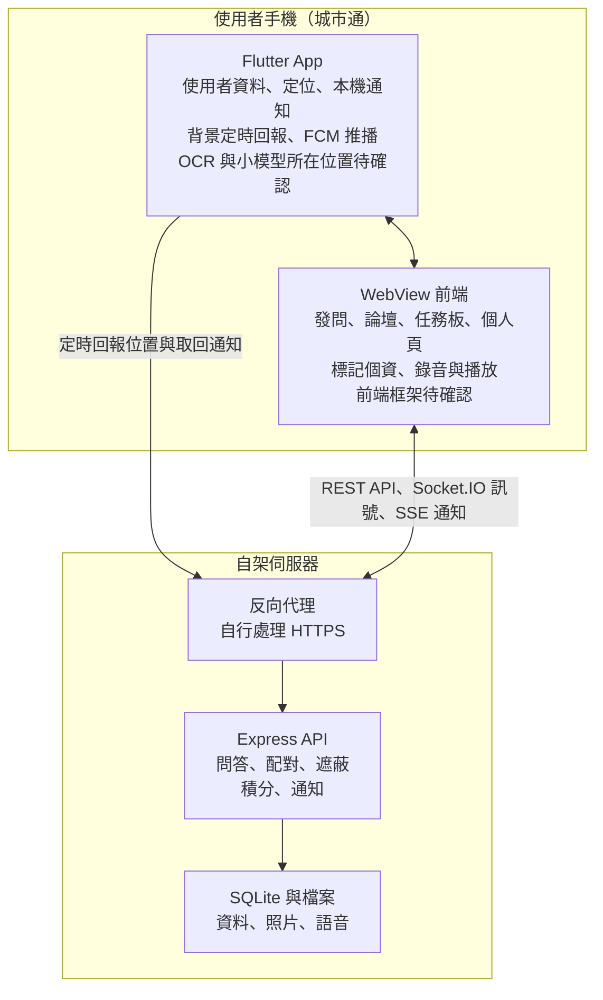

# 看不懂互助論壇：專案架構討論稿

2026-11-07 · @codingbear

我們要在城市通裡做一個公開的互助論壇，讓看不懂的人發問，由線上或附近的人解決。架構已可討論，但有 15 項是白板之後才加入的，開工前要先由組員確認。

## 待組員確認

以下 15 項都不在原始白板上，影響最大的是第 2、4、8、9 項，因為會增加 Flutter 或手機端的工作。請直接在「決定」欄填入同意、修改或不做。

| # | 項目 | 目前做法 | 來源 | 要確認什麼 | 決定 |
| --- | --- | --- | --- | --- | --- |
| 1 | 問答全公開 | 不做私訊，營運與審核交給主辦單位 | 後端補充 | 大家能接受長輩的問題公開嗎？ |  |
| 2 | 手機端遮蔽個資 | 上傳前用 OCR 和小模型框出個資，發問者確認後才上傳 | 後端補充 | 誰來做？要放 Flutter 還是 WebView？模型跑得動嗎？ |  |
| 3 | 社群標記個資 | 任何人可標記，發問者選擇 accept 或 deny | 後端補充 | 這個流程對長輩會不會太複雜？ |  |
| 4 | 到現場協助 | 除了線上回答，也能接任務到現場 | 後端補充 | 白板只有 Nearby，大家原本有想到現場嗎？目前沒有現場安全機制，可以接受嗎？ |  |
| 5 | 語音發問與回答 | 按住錄音上傳，不做語音轉文字 | Claude 提議，後端選定 | 前端要做錄音和播放，要放進 Demo 嗎？ |  |
| 6 | 自動帶入城市通情境 | 從功能頁發問時，自動帶功能名稱和頁面路由 | 後端補充 | 只做示範頁面，還是接上所有功能？ |  |
| 7 | 正讚與倒讚 | 倒讚數學 YouTube 不公開，避免情緒性倒讚；由後端用於回答排序和可信度評分，不影響積分 | 後端補充 | 低可信度帳號暫定排序下降、收不到附近通知、不能接現場任務，可以接受嗎？ |  |
| 8 | 伺服器推播 | 只做 Android，用 Firebase FCM；App 連線時走 SSE | 後端補充 | 誰在 Flutter 接 FCM？Demo 用什麼手機？ |  |
| 9 | 背景定位 | App 定時回報位置，用來通知附近的人 | Claude 提議，後端選定 | 誰改 Flutter？使用者授權流程怎麼設計？ |  |
| 10 | 任務板 | 動森島民出任務只是問題列表的遊戲化呈現 | Claude 提議，後端選定 | 這符合白板原本的意思嗎？ |  |
| 11 | 位置分享等級 | 完全關閉、模糊位置（預設）、具體位置三級；公開頁一律只顯示約 500 公尺內的位置；選模糊位置時，現場問題有人接案後才把精確位置給接案者 | 後端補充，細節由 Claude 提議 | 這三級的預設值和現場協助規則，大家同意嗎？ |  |
| 12 | 待決定的個資標記 | 內容持續隱藏，不會逾時自動公開 | Claude 提議 | 有人亂標記時，問題可能一直被隱藏，可以接受嗎？ |  |
| 13 | 積分規則 | 只有被採納或現場任務完成才加分；暫定 +10 和 +30 | Claude 提議 | 這樣的誘因足夠嗎？ |  |
| 14 | 外語支援 | 記錄語言供篩選，不做自動翻譯 | Claude 提議 | 外國人是主要客群，只有篩選夠嗎？ |  |
| 15 | 後端技術 | Express、SQLite、Socket.IO，只提供 HTTP；反向代理與 HTTPS 自行處理 | Claude 提議 | 主要影響後端，前端只需確認 API 串接方式 |  |

## 產品

比賽主題是數位平權 × 友善共融，我們選「看不懂」。規則不能用外部 LLM，手機端模型又難以回答各種問題，所以改由人幫人。

- **發問者：** 長者、外籍人士等數位弱勢者，操作要做到不比 LINE 或 Messenger 難。
- **解決者：** 熱心的數位原生世代，用論壇回答問題並獲得成就感。
- **問題範圍：** 看不懂地圖、行政程序和文字；也包含公文、合約、疑似詐騙和城市通內的操作。
- **差異點：** 直接在城市通裡發問，也符合城市通「市民共同參與」的精神。

白板原有內容：Global/Nearby 即時論壇、徽章與社群分享、獎勵機制、即時訊息、推播通知附近的人、動森島民出任務。

## 系統架構

整個專案是城市通內的一個 WebView 功能，後端只需要一個 API 服務。工作量的變數主要在 Flutter 和手機端模型。

| 層 | 白板就有的工作 | 後來新增的工作 |
| --- | --- | --- |
| WebView 前端 | 論壇、即時更新、徽章分享、任務板 | 語音錄放、個資標記與確認、現場任務、讚與倒讚 |
| Flutter App | 提供使用者資料、定位、通知 | 各功能頁的發問入口、背景定位、接 FCM 推播 |
| 手機端模型 | 無 | OCR 與小模型偵測個資 |
| 後端 | 問答、附近配對、積分徽章、Socket.IO 更新訊號、SSE 與 FCM 通知 | 現場任務狀態、圖片遮蔽、位置分享等級 |

**Demo 限制：** 城市通的 `userinfo` 沒有簽章，後端無法驗證使用者身分，正式上線前需要城市通提供可驗證的 token。

## 主流程

所有流程都從同一個問題開始，問題解決的條件是發問者採納回答或確認現場完成。

| 流程 | 步驟 | 結果 |
| --- | --- | --- |
| 發問 | 從城市通功能頁或論壇進入 → 打字、拍照或錄音 → 手機遮蔽個資 → 送出 | 問題公開，並通知附近的人 |
| 線上回答 | 解決者從論壇或任務板回答 → 其他人投正讚或倒讚 → 發問者採納 | 問題解決，回答者得分 |
| 現場協助 | 附近的人接任務 → 取得精確位置 → 抵達 → 發問者確認完成 | 問題解決，接案者得分，精確位置清除 |
| 個資標記 | 有人標記漏網的個資 → 內容先隱藏 → 發問者選擇 accept 或 deny | accept 後永久遮蔽，deny 後恢復顯示 |

## Demo 範圍

比賽時間有限，建議先完成一條能實機展示的主線：從城市通發問、附近的人收到通知、回答、採納並拿到積分。以下是建議順序，會依上方確認結果調整。

| 優先序 | 內容 |
| --- | --- |
| 先做 | 發問、論壇、回答與採納、讚與倒讚、即時更新、附近篩選與通知、自動帶入情境 |
| 其次 | 現場協助、個資標記、手機端遮蔽、積分徽章、任務板 |
| 時間夠再做 | 社群分享 |
| 不做 | 審核後台、實質獎勵兌換、自動翻譯、私訊、iOS |
